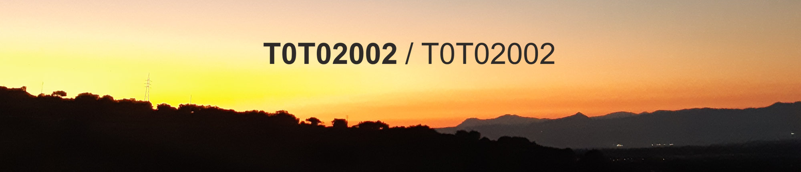

  
  
  

## Ciao, sono Salvatore Madeddu
Sono uno studente del corso di laurea magistrale in **Cloud and Security** all'Università degli Studi di Cagliari.

Nel 2026 ho conseguito la laurea triennale in **Informatica** presso la medesima università.
 
 

## Linguaggi
Segue una lista di linguaggi che utilizzo oppure ho utilizzato in passato per diversi progetti:

  

## Tecnologie
Segue una lista di software o librerie che ho utilizzato in passato per diversi progetti:

  

## Contatti
I miei profili:

  
  

<!--
**T0T02002/T0T02002** is a ✨ _special_ ✨ repository because its `README.md` (this file) appears on your GitHub profile.

Here are some ideas to get you started:

- 🔭 I’m currently working on ...
- 🌱 I’m currently learning ...
- 👯 I’m looking to collaborate on ...
- 🤔 I’m looking for help with ...
- 💬 Ask me about ...
- 📫 How to reach me: ...
- 😄 Pronouns: ...
- ⚡ Fun fact: ...
-->
