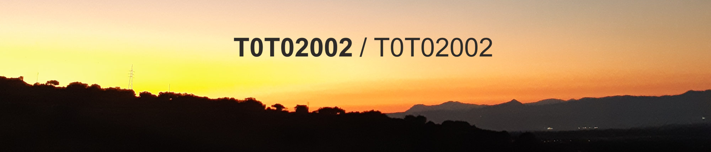

  
  
  

## Hi, I'm Salvatore Madeddu
I'm an MSc student in **Cloud and Security** at the University of Cagliari.

In 2026 I earned my Bachelor's degree in Computer Science from the University of Cagliari.
 
 

## Stack
Here is a list of programming languages I use or have worked with across various projects:

  

## Technologies
Here is a list of software, tools, and libraries I have used in various projects:

  

## Contacts 
My profiles:

  
  

<!--
**T0T02002/T0T02002** is a ✨ _special_ ✨ repository because its `README.md` (this file) appears on your GitHub profile.

Here are some ideas to get you started:

- 🔭 I’m currently working on ...
- 🌱 I’m currently learning ...
- 👯 I’m looking to collaborate on ...
- 🤔 I’m looking for help with ...
- 💬 Ask me about ...
- 📫 How to reach me: ...
- 😄 Pronouns: ...
- ⚡ Fun fact: ...
-->
